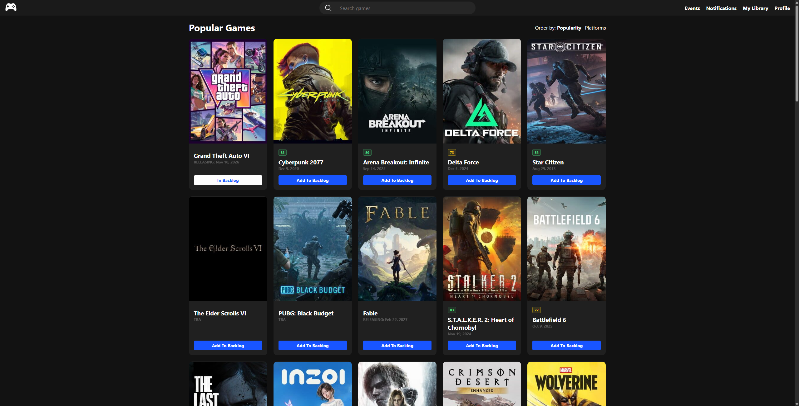
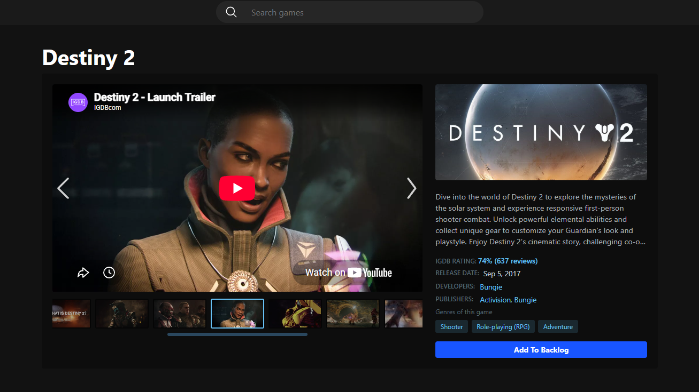
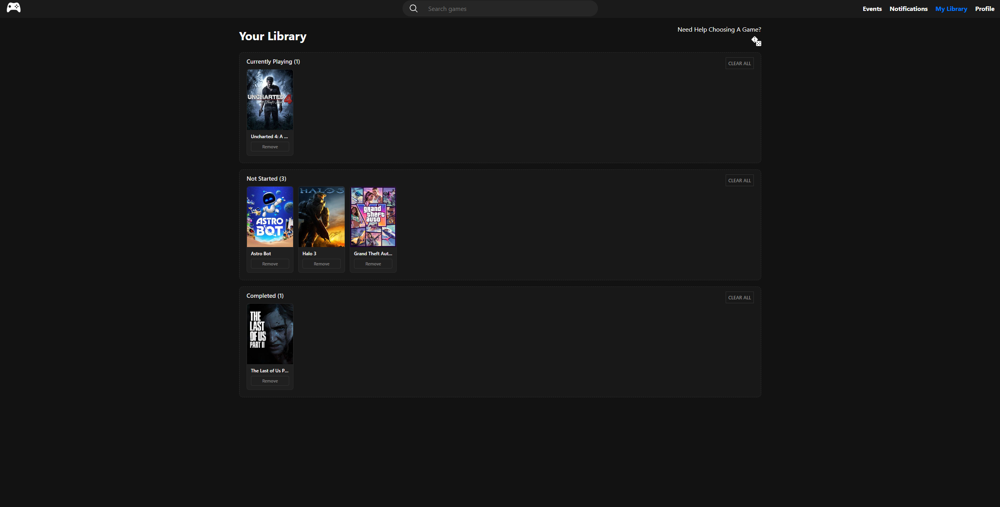
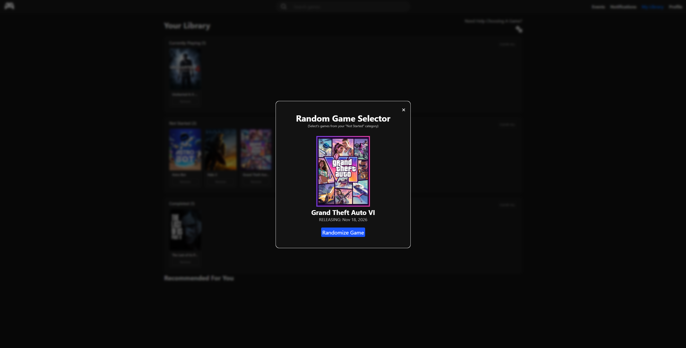

# Game Tracker

A full-stack web application built with **React 19**, **Vite**, **Express 5**, and **CSS3** that enables users to browse, search, and manage a personalized video game backlog using live metadata from the **Internet Game Database (IGDB) API**.

---
### Images

<p align="center">
  <a href="public/screenshots/Main-Homepage.png">
    
  </a>
</p>

<p align="center">
  <a href="public/screenshots/Game-Details-Page.png">
    
  </a>
</p>

<p align="center">
  <a href="public/screenshots/Library-Page.png">
    
  </a>
</p>

<p align="center">
  <a href="public/screenshots/Random-Game-Selector.png">
    
  </a>
</p>

## Features

### Game Discovery & Live Search
* **Popular Titles Catalog:** Automatically fetches high-hype releases with dynamic score badges, release dates, and box art.
* **Live Search Routing:** Dynamically queries IGDB across main games, remakes, remasters, and expanded editions.
* **Responsive Grid:** Dynamic CSS grid layout displaying cover art, formatted release dates, platform tags, and rating badges.

### Interactive Game Details (`/games/:slug`)
* **Unified Media Showcase:** Synchronized video and screenshot carousel featuring embedded YouTube trailers, 1080p high-resolution images, and interactive navigation controls.
* **Auto-Centering Thumbnail Strip:** Horizontal mouse-wheel scrolling that automatically centers on the currently active media asset.
* **Fullscreen Lightbox:** Immersive modal viewer with arrow-key switching and backdrop dismiss.
* **Live Launch Countdown:** Client-side interval counter tracking days, hours, minutes, and seconds until unreleased titles launch.
* **Comprehensive Metadata:** Displays developers, publishers, genre tags, storylines, summaries, and aggregate IGDB review scores.

### Interactive Backlog & Library Management (`/library`)
* **Multi-Shelf Organization:** Categorize titles across three status lanes: **Currently Playing**, **Not Started**, and **Completed**.
* **HTML5 Drag-and-Drop:** Intuitive drag-and-drop mechanics to reassign games across shelves, complete with active drop-zone visual feedback.
* **One-Click Backlog Toggle:** Add or remove games directly from catalog cards or game detail pages via a centralized `useLibrary` hook.
* **Shelf Maintenance:** Clear entire shelves or remove individual titles with instant state synchronization.
* **LocalStorage Persistence:** Backlog collections persist automatically in the browser's `localStorage` across sessions.

### Random Game Picker
* **Decision Helper Modal:** Built-in randomized selector that samples titles specifically marked as **Not Started** to help eliminate choice paralysis.
* **Dynamic Validation:** Prevents duplicate rolls and ensures a sufficient number of unstarted games are present before rolling.

### Gaming Industry Events (`/events`)
* **Event Discovery:** Fetches gaming conventions, showcases, and livestreams from IGDB's `/events` endpoint through the Express backend.

---

## Tech Stack

* **Frontend:** React 19, React Router 7, HTML5 Drag and Drop API, CSS3 (Flexbox & CSS Grid)
* **Backend:** Node.js, Express 5, Axios, CORS, Dotenv
* **Build Tool:** Vite 8
* **Data Source:** [IGDB API v4](https://api-docs.igdb.com/) (Twitch OAuth Client Credentials)

---

## Architecture Overview

```text
Browser (React 19 / Vite :5173)
       │
       │  HTTP REST (/api/games/popular, /api/games/search, /api/games/:slug, /api/events)
       ▼
Express Proxy Server (:5000)
       │
       │  • Manages Twitch OAuth2 token lifecycle & auto-renewal
       │  • Injects Client-ID and Bearer headers
       │  • Formats raw IGDB query payloads for frontend consumption
       ▼
Twitch / IGDB API (v4)
```

The Express proxy server (server.js) handles communication with IGDB, keeping Twitch API credentials on the server rather than exposing them to the browser. It manages OAuth access tokens, retries requests when a token is rejected with a 401 Unauthorized response, and formats API responses for the frontend.

---

## API Endpoints

| Method | Endpoint | Description |
| :--- | :--- | :--- |
| `GET` | `/api/games/popular` | Retrieves top 50 games sorted by community hype. |
| `GET` | `/api/games/search?q=:term` | Searches games by title across base games, remakes, and expansions. |
| `GET` | `/api/games/:slug` | Returns detailed metadata, screenshots, videos, and credits for a specific title. |
| `GET` | `/api/events` | Fetches industry events, schedules, logos, and associated trailers/games. |
| `GET` | `/api/events/:id` | Returns single event details. |

---

## Project Structure

```text
├── public/
│   └── game-images/             # Fallback and static card assets
├── src/
│   ├── assets/                  # Icons, controller branding, platform logos
│   ├── components/
│   │   ├── Header.jsx           # Global navigation and search input
│   │   ├── Header.css
│   │   ├── YoutubePlayer.jsx    # Standalone iframe helper
│   │   └── Modals/
│   │       ├── Modal.jsx        # HTML5 dialog wrapper
│   │       └── Modal.css
│   ├── hooks/
│   │   └── LibraryContext.jsx       # Centralized backlog state and localStorage sync
│   ├── pages/
│   │   ├── home/
│   │   │   ├── HomePage.jsx     # Discover & catalog container
│   │   │   ├── GameGrid.jsx     # Dynamic card grid layout
│   │   │   ├── GameCard.jsx     # Individual card with backlog toggle
│   │   │   └── HomePage.css
│   │   ├── game details page/
│   │   │   ├── GameDetails.jsx  # Showcase, lightbox, and metadata view
│   │   │   ├── ReleaseCountdown.jsx
│   │   │   └── GameDetails.css
│   │   ├── Library Page/
│   │   │   ├── Library.jsx      # Shelf container & drop targets
│   │   │   ├── BacklogColumn.jsx# Individual status lane
│   │   │   ├── LibraryCard.jsx  # Draggable backlog item
│   │   │   ├── RandomGameModal.jsx # Backlog randomizer
│   │   │   └── Library.css
│   │   └── Events/
│   │       └── EventsPage.jsx   # Gaming events dashboard
│   ├── utils/
│   │   ├── slugify.js           # URL slug parser
│   │   └── time.js              # Countdown calculation utility
│   ├── App.jsx                  # React Router configuration
│   ├── main.jsx                 # Application entry point
│   └── index.css                # Global base styles
├── .env.example                 # Environment template
├── .gitignore
├── package.json
├── server.js                    # Express proxy & IGDB integration
└── vite.config.js
```

---

## Getting Started

### Prerequisites

* [Node.js](https://nodejs.org/) (v18 or higher recommended)
* A [Twitch Developer Portal](https://dev.twitch.tv/console) account with a registered application (`Client ID` and `Client Secret`)

### Installation & Local Setup

1. **Clone the repository:**
   ```bash
   git clone https://github.com/TMA033/Video-Game-Backlog.git
   cd Video-Game-Backlog
   ```

2. **Install dependencies:**
   ```bash
   npm install
   ```

3. **Configure Environment Variables:**
   Create a `.env` file in the project root:
   ```env
   PORT=5000
   TWITCH_CLIENT_ID=your_twitch_client_id_here
   TWITCH_CLIENT_SECRET=your_twitch_client_secret_here
   ```

4. **Run the Application:**
   Start both the Express backend and the Vite frontend simultaneously with a single command:
   ```bash
   npm run dev:full
   ```
   * *Backend server runs on `http://localhost:5000`*
   * *Frontend client runs on `http://localhost:5173`*

   *(Optional: You can also run them individually in separate terminals using `npm run start:server` and `npm run dev`)*

5. Open your browser and navigate to `http://localhost:5173`.

---

## Roadmap

- [ ] Complete UI and layout for the Events page (`/events`).
- [ ] Connect the "Recommended For You" carousel in the Library view.
- [ ] Add genre and platform dropdown filters to the catalog view.
- [ ] Implement user authentication and database persistence.

---

## Author

* **Toyosi Adeniji** — [GitHub](https://github.com/TMA033)
